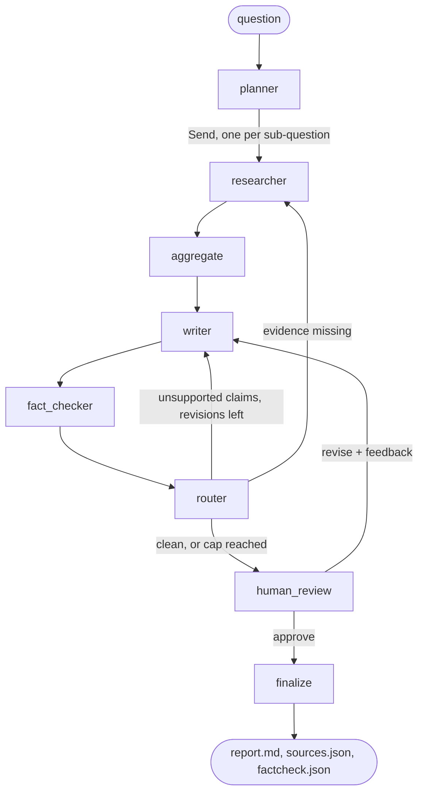

# Multi-Agent Research Analyst

LangGraph agents that research a question on the open web and write a cited report. A planner splits the question, researchers work in parallel, a writer drafts, a fact-checker sends weak claims back for rewrites, and a person approves the result before anything is saved.

[](https://github.com/arjavtongia/multi-agent-research-analyst/actions/workflows/ci.yml)
[](https://www.python.org/)
[](LICENSE)

**See a real run:** [`docs/example-run/report.md`](docs/example-run/report.md) answers "How do passkeys work, and what problems do they solve compared with passwords?" Six researchers ran in parallel and kept 93 quote-backed notes from 22 sources. The writer went through two automatic revisions, and the final draft passed with 31 of 31 cited claims supported. It took 12 minutes and 174k tokens on NVIDIA's free tier. The same folder has the source list, every fact-check verdict and the per-node trace.

## Why a graph and not one agent

Ask a single model to "research X and write a report" and it decides when to stop searching, quotes pages it never opened and grades its own homework. I wanted to see how far plain engineering gets instead: control flow written in code, small agents with one job each, evidence that must appear word for word on a fetched page, a separate checker with a hard cap on rewrites, and a human at the end.



- **planner** turns the question into 3 to 6 sub-questions and a report outline.
- **researcher** runs once per sub-question, in parallel through LangGraph's `Send`. It searches, fetches the top pages with httpx, pulls readable text with trafilatura, and has the fast model extract claims with supporting quotes. A note survives only if its quote appears verbatim on the page.
- **aggregate** dedupes sources by normalised URL and hands out ids `[S1]..[Sn]` that never change, so a later research pass can't break citations in an existing draft.
- **writer** drafts markdown that cites every factual sentence.
- **fact_checker** labels each sentence supported, unsupported or missing a citation. Cheap deterministic checks run first, so the model only judges what needs judgement.
- **router** is plain code. It sends the draft back with the findings, or runs one targeted research pass for missing evidence, at most `MAX_REVISIONS` (2) times.
- **human_review** pauses the graph with `interrupt()`. You approve or ask for changes in free text, from the CLI, the API or the UI, even from another process, because state is checkpointed to SQLite.

## Results

`research-agents eval` ran all 10 questions in [`data/eval/questions.yaml`](data/eval/questions.yaml) (technology, economics, science) end to end on 2026-10-06, with auto-approval.

| Metric | Result |
|---|---|
| Runs completed | 10 / 10 |
| Citation coverage (factual sentences with a citation) | 90.7% mean; 100% on 9 of 10 |
| Supported-claim rate (fact-checker verdict) | 91.8% mean; 87.5% to 100% on 9 of 10 |
| Unique sources cited per report | 9.7 |
| Automatic revisions | 1.2 |
| Median run time | 11.4 minutes |
| Tokens per report | about 105k |

The outlier was the four-day-week question: 6.8% coverage. The report itself read fine. The model had written its citations as `【S3】` instead of `[S3]`, my citation parser didn't recognise the CJK brackets, and 41 properly sourced sentences counted as uncited. Two rewrites couldn't fix it because the model kept the same brackets. The parser now normalises them. A fresh run of that question after the fix reached 100% coverage with 31 of 32 claims supported (a new run, so the web results differ too).

Supported-claim rate is one model's opinion of another's work, not ground truth. I read several reports in full before trusting the numbers; [`reports/eval_report.md`](reports/eval_report.md) has the per-question table.

## What broke on the first live runs

The offline tests passed from the start. These all came from running against real search and real models:

- **Search returned nothing for 4 of 5 sub-questions.** Keyless engines soft-block bursts by answering "No results found". The DuckDuckGo backend alone answered 1 of 5 ordinary queries in a quick test. Each query now walks Yahoo, then Bing, then DuckDuckGo, and treats "no results" from one engine as a cue to ask the next.
- **A rewrite came back as a 129-word fragment ending mid-citation.** The reasoning model spent most of the 4,096-token output limit thinking, and the fact-checker happily approved the five sentences that were left. The limit is now 16,384, and the writer checks `finish_reason`: a cut-off revision keeps the previous draft, and a cut-off first draft gets an explicit "incomplete" marker.
- **One slow reply killed a run in the middle of research.** NVIDIA's free tier sometimes takes over two minutes, and a single read timeout ended the whole graph. Model calls now retry timeouts, dropped connections, 429s and 5xx errors with backoff, and the timeout is 300 s.
- **NVIDIA's guided JSON returned valid but empty fields** in a sibling project, so structured output here asks for JSON in the prompt and validates it with pydantic on NVIDIA-served models instead.

## Run it

You need [uv](https://docs.astral.sh/uv/) and a free key from [build.nvidia.com](https://build.nvidia.com). Search needs no key.

```bash
git clone https://github.com/arjavtongia/multi-agent-research-analyst.git
cd multi-agent-research-analyst
uv sync
cp .env.example .env      # Windows: Copy-Item .env.example .env, then set NVIDIA_API_KEY
uv run research-agents run "How do passkeys work, and what problems do they solve?"
```

The run prints a line per finished node, then pauses with the draft and the fact-check summary. Resume it later, from any terminal:

```bash
uv run research-agents resume <thread_id> --approve
uv run research-agents resume <thread_id> --revise "Add a paragraph on account recovery and cite it."
uv run research-agents run "How does CRISPR base editing work?" --auto-approve
uv run research-agents eval --limit 3
uv run research-agents serve                    # POST /runs, GET /runs/{id}, POST /runs/{id}/review
uv sync --extra ui && uv run streamlit run app/streamlit_app.py
```

Each run writes `runs/<thread_id>/report.md`, `sources.json`, `factcheck.json` and `trace.jsonl` (one line per node with duration, tokens and LLM calls). Set `LANGSMITH_TRACING=true` and `LANGSMITH_API_KEY` for full LangSmith traces; no code changes needed.

## Configuration

| Setting | Default |
|---|---|
| `LLM_PROVIDER` | `nvidia`; also `openai`, `azure`, `anthropic` |
| main / fast model on NVIDIA | `nvidia/nemotron-3-super-120b-a12b` / `openai/gpt-oss-20b` |
| `SEARCH_PROVIDER`, `DDGS_BACKEND` | `auto` (Tavily if `TAVILY_API_KEY` is set), `yahoo,bing,duckduckgo` |
| `MAX_SOURCES_PER_QUESTION`, `MAX_PAGE_CHARS` | 3, 6000 |
| `MAX_REVISIONS`, `TOKEN_BUDGET` | 2, 300,000 |
| `LLM_MAX_OUTPUT_TOKENS`, `LLM_TIMEOUT_S` | 16,384, 300 |

[`.env.example`](.env.example) has the full list, including Azure deployments and the blocked-domains list.

## Keeping web pages from steering the agents

Every fetched page is untrusted input. Page text, titles and snippets go into prompts inside randomly tagged `UNTRUSTED_WEB_CONTENT` blocks, and anything in the page that looks like a delimiter gets neutralised first so a page can't close its own block. Every prompt that sees web content says never to follow instructions inside those blocks. Pages are truncated and capped at 2 MB. The models have no tools: the graph decides which URLs to fetch, so a hijacked extraction can at worst produce a bad note, and quote grounding drops most of those. Phrases like "ignore previous instructions" get flagged in the research log rather than blocked, since a page about prompt injection is legitimate content. The example passkeys run flagged one such page.

## Limits

A token budget stops a run cleanly with a partial report marked as unreviewed. Source quality goes no further than a domain blocklist and quote grounding; there's no credibility scoring, and that's the main gap. Paywalled pages fall back to the search snippet, labelled as such in the source list.

## Tests

84 tests run offline with a scripted fake model and fake search and fetch tools (`uv run pytest`). They cover the routing loop and its cap, parallel fan-out, source id stability, quote grounding, prompt-injection delimiting, the token budget, truncated drafts, retries, CJK citation brackets, and pausing in one process then resuming in another.

## License

MIT. Copyright 2026 Arjav Tongia.
